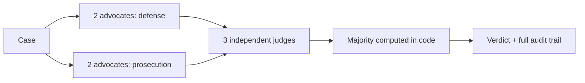

<h1>Hi, I'm Shlomi Hazan 👋</h1>

  

  

## 👨‍💻 About
 
I'm a Computer Science student at **HIT – Holon Institute of Technology**, in the honors program on an accelerated **B.Sc. + M.Sc.** track. Before university I served as a **combat team commander** in the IDF Artillery Corps, which taught me to lead a team and make decisions under pressure.
 
I care about both halves of building software: the **engineering** that makes a product reliable, and the **research questions** that decide whether it's worth building. I'm most drawn to AI-powered applications and to how people actually interact with AI.
 
## ⭐ Flagship: The Tribunal
 
**An AI courtroom where disagreement is the point.** Four advocates (two for the defense, two for the prosecution) argue a case, three judges rule independently, and a **deterministic rule written in code**, never an extra model call, decides the verdict. Every token, dollar, and second of the deliberation is recorded and inspectable.
 

 

<a href="https://ase26-the-tribunal.netlify.app"><b>🚀 Live app</b></a> ·
<a href="https://github.com/Shlomi-Hazan/ase26-the-tribunal"><b>Code</b></a> ·
<code>React</code> <code>TypeScript</code> <code>Supabase</code> <code>OpenRouter</code>

## 🚀 Featured projects
 
| Project | What it does | Stack |
|:--|:--|:--|
| 💿 [**Vinyl Intelligence**](https://github.com/Shlomi-Hazan/vinyl-intelligence) · [live](https://vinyl-intelligence.netlify.app) | Vinyl collection app with **VIN**, an AI curator that recommends only from records you own. Scan a cover to identify an album. Hebrew-aware. | `React` `TypeScript` `Supabase` `AI Vision` |
| 💰 [**Cost Manager Pro**](https://github.com/Shlomi-Hazan/cost-manager-pro) · [live](https://cost-manager-pro.vercel.app) | Local-first expense manager with multi-currency tracking, reports, charts, and Excel/PDF export. Started as a university project; I now lead its development. | `React` `Vite` `MUI` `Vitest` |
| 🌐 [**Botchat**](https://github.com/Shlomi-Hazan/Chat-Bot-) | TCP/IP project combining manual packet analysis with a real-time client-server chat over raw sockets. | `Python` `TCP/IP` `NiceGUI` |
| 🖼️ [**AI vs. Real Images**](https://github.com/Shlomi-Hazan/AI-vs-Real-Images-ML-Project) | Classifier for AI-generated vs. real images: KNN built from scratch with feature engineering. | `Python` `ML` `Jupyter` |
 
## 🧰 Tech & tools
 

 

<b>📂 More projects (coursework, experiments, earlier work)</b>

 
<table>
<tr><th align="left">Area</th><th align="left">Project</th><th align="left">Description</th></tr>
<tr><td>🤖 AI</td><td><a href="https://github.com/Shlomi-Hazan/gmail-intelligence">Gmail Intelligence</a></td><td>Privacy-conscious, local-first Gmail analysis and organization</td></tr>
<tr><td>🔬 Research</td><td><a href="https://github.com/Shlomi-Hazan/attention-is-all-you-need-research">Attention Is All You Need</a></td><td>Presentation highlights and reflections on the Transformer paper</td></tr>
<tr><td>📈 Finance</td><td><a href="https://github.com/Shlomi-Hazan/value-stock-finder">Value Stock Finder</a></td><td>Educational stock screening and valuation tools</td></tr>
<tr><td>💰 Finance</td><td><a href="https://github.com/Shlomi-Hazan/cost-manager-front-end">Cost Manager (original)</a></td><td>The front-end course project that Cost Manager Pro grew out of</td></tr>
<tr><td>🌐 Web</td><td><a href="https://github.com/Shlomi-Hazan/Shlomi-Hazan.github.io">Portfolio Website</a></td><td>Source of my <a href="https://shlomi-hazan.github.io/">personal site</a> (HTML, CSS, JavaScript)</td></tr>
</table>

 
<b>Always learning. Always building.</b>
 
<a href="https://shlomi-hazan.github.io/">Explore my portfolio →</a>

 
